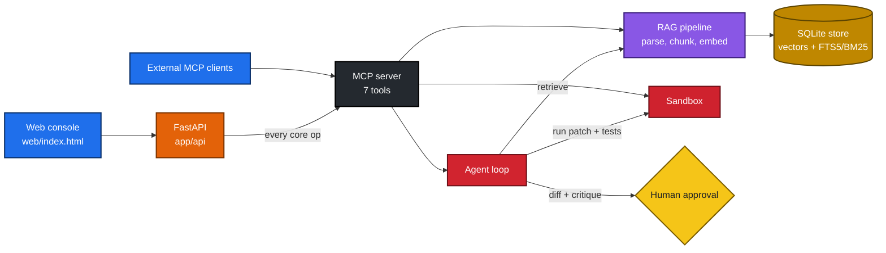
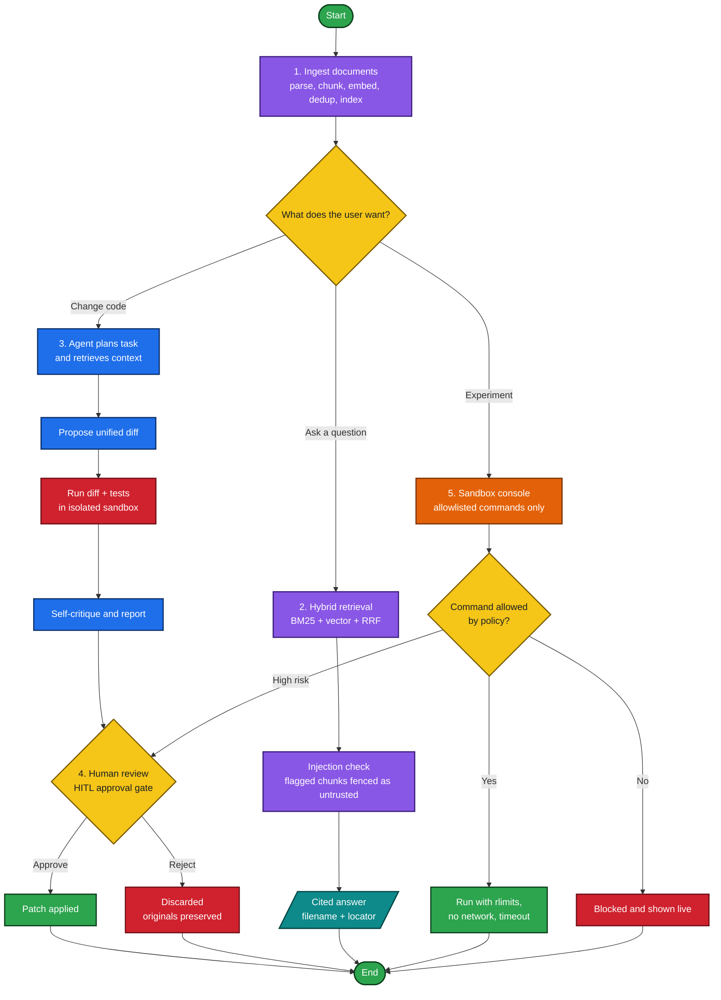

# AegisDev: Human-in-the-Loop (HITL) AI Developer Platform

**A privacy-first, human-in-the-loop (HITL) AI developer platform:** an MCP server, a local RAG
pipeline with hybrid search, and a sandboxed code-generation agent, wired into one web app and API.
The AI proposes; a human decides.

Give it documents and a repository. Ask questions and get **cited** answers, or request a
coding change, review the proposed **unified diff**, run it in an **isolated sandbox**, and
explicitly **approve or reject** it. Every consequential action passes through a **human-in-the-loop
(HITL) approval gate**, so nothing is applied silently.

Everything runs at **zero cost**: local embeddings (with an offline fallback), an in-memory
index that needs no persistent disk, and no paid APIs or keys.

- **Live demo:** [AegisDev on Render](https://aegisdev.onrender.com/) (free tier, so the first request after idle may take 30 to 60 seconds)
- **Source:** [github.com/sourabhvamdevan/Aegisdev](https://github.com/sourabhvamdevan/Aegisdev)


---

## Table of Contents

- [Highlights](#highlights)
- [Architecture](#architecture)
- [Quickstart](#quickstart)
- [Product workflow](#product-workflow)
- [MCP tools and REST API](#mcp-tools-and-rest-api)
- [Hybrid search (BM25 + vector)](#hybrid-search-bm25--vector)
- [Security model](#security-model)
- [Configuration](#configuration)
- [Deploy to Render (free)](#deploy-to-render-free)
- [Testing and quality](#testing-and-quality)
- [Real code generation with a local LLM](#real-code-generation-with-a-local-llm)
- [Roadmap (planned, not implemented yet)](#roadmap-planned-not-implemented-yet)

---

## Highlights

| | |
|---|---|
| **MCP server** | Official SDK. 7 typed tools, 1 resource (`aegisdev://status`), 1 prompt (`code_review`), per-tool timeouts. |
| **Hybrid search** | SQLite FTS5 (BM25) + local vectors, fused with Reciprocal Rank Fusion. Identifier-aware, so exact function names are found reliably. |
| **Cited RAG** | PDF / Markdown / text / JSON / Python / JS / TS ingestion; every result carries filename + locator. Dedup, incremental re-index, deletion. |
| **Prompt-injection defence** | Retrieved text is fenced as untrusted data; injection patterns are detected and reported. |
| **Sandboxed agent** | Plan, retrieve, patch, sandbox, critique, report. Success is claimed only on a real zero exit. |
| **Deny-by-default sandbox** | Command allowlist, workspace jail, rlimits, no network, wall-clock timeout, output cap. |
| **Human-in-the-loop (HITL) approval gate** | Applying a patch, enabling network, or running a high-risk command needs explicit human approval. |
| **Local LLM option** | Plug in Ollama for real patch synthesis, still private and free. |

---

## Architecture



| Path | Responsibility |
|------|----------------|
| `app/mcp_server/` | MCP server: tools, resource, prompt, timeouts, validation. |
| `app/rag/` | Parsers, chunker, local embeddings, hybrid SQLite store, lexical helpers, injection defence. |
| `app/sandbox/` | Isolated executor: allowlist policy, workspace jail, rlimits, network denial, timeouts. |
| `app/agent/` | Execution loop and patch generators (built-in placeholder, Ollama). |
| `app/api/`, `app/main.py` | FastAPI app; every core operation is routed **through MCP tools**. |
| `web/` | Single-file security console UI (no build step). |
| `tests/` | 56 tests, including adversarial sandbox and injection tests. |
| `eval/` | Reproducible retrieval eval (14 questions, recall@k, vector vs lexical vs hybrid). |

---

## Quickstart

```bash
# 1. install
python -m venv .venv && source .venv/bin/activate
pip install -r requirements-dev.txt

# 2. run all automated checks (tests + retrieval eval)
make check

# 3. start the app
make run            # http://localhost:8000  (UI, /docs, /mcp)
```

With Docker:

```bash
make docker         # docker compose up --build
```

Open `http://localhost:8000` for the console. `GET /docs` is the generated OpenAPI surface and
`/mcp` is the MCP endpoint for external MCP clients.

---

## Product workflow

1. **Ingest.** Upload or paste documents. RAG parses, chunks, embeds, deduplicates and indexes
   them with source metadata.
2. **Ask.** Cited retrieval (filename + locator); injection-flagged chunks are fenced as untrusted.
3. **Change.** Submit a coding task. The agent plans, retrieves, proposes a unified diff, runs it
   in the sandbox, and self-critiques.
4. **Decide (HITL).** A human reviews the diff, sandbox result and critique, then approves or rejects the patch.
5. **Experiment.** The sandbox console runs allowlisted commands and shows the policy blocking
   unsafe ones live.

### Workflow diagram



## MCP tools and REST API

| MCP tool | Purpose |
|----------|---------|
| `ingest_document` | Parse, chunk, embed and index a document. |
| `retrieve_context` | Hybrid retrieval with citations and injection flags. |
| `inspect_repository` | Summarise a repository directory. |
| `propose_patch` | Run the agent loop and return a diff, sandbox result and critique. |
| `run_in_sandbox` | Run an allowlisted command in the isolated sandbox. |
| `system_status` | Index stats, embedding backend, retrieval mode. |
| `delete_content` | Remove indexed content by source. |

REST endpoints (all under `/api`, each delegating to the tools above): `GET /health`,
`GET /status`, `POST /ingest/text`, `POST /ingest/file`, `DELETE /ingest/{source}`,
`POST /query`, `POST /task`, `POST /approve`, `POST /sandbox/run`, `POST /repo/inspect`.

---

## Hybrid search (BM25 + vector)

Retrieval fuses two rankers over the same chunks, all inside SQLite (no extra service):

- **Dense.** Local embeddings, exact cosine similarity.
- **Sparse.** SQLite **FTS5 / BM25**, identifier-aware: `get_user_by_id` and `getUserById` are
  indexed as the whole token, their sub-words, and one canonical joined key, so a camelCase query
  finds a snake_case definition and vice versa. Query terms are quoted individually, so user text
  cannot inject FTS syntax.
- **Fusion.** Reciprocal Rank Fusion (`k = 60`). When the query names an identifier, BM25 gets 2x
  weight, and a clear BM25 outlier (top score at least 1.5x the runner-up) is pinned to rank 1 as
  an exact-identifier fast path. The returned `score` is normalised to 0..1.

Modes: `RETRIEVAL_MODE=hybrid|vector|lexical` (default `hybrid`); `retrieve(..., mode=...)`
overrides per call. If SQLite has no FTS5 the store degrades to vector-only and reports it in
`stats()["lexical_backend"]`. Existing databases are backfilled into the FTS index on startup.

```bash
python -m eval.run_eval --compare   # recall@k: vector vs lexical vs hybrid
```

**Honest note.** The bundled eval corpus is tiny (7 files), so all three modes reach 1.00 there.
The separation shows up in `tests/test_hybrid_search.py`, which buries one exact identifier among
40 look-alike chunks: dense-only retrieval ranks a distractor first, hybrid ranks the real
definition first. Add cases from your own repository before trusting the weights.

---

## Security model

- **Deny by default.** `app/sandbox/policy.py` lists every allowed command, file type and
  resource limit in one auditable place.
- **Workspace jail.** Paths are resolved and confirmed to stay under the sandbox root, blocking
  `../` traversal and symlink escape.
- **Resource limits.** CPU, address space, process count (fork-bomb guard), file size and open
  files, set with POSIX rlimits in a child preexec hook.
- **No network by default.** Enabling it is an explicit, approval-gated action.
- **Wall-clock timeout** kills the whole process group. **Output cap** truncates runaway output.
- **Untrusted retrieval.** Document content is fenced and never treated as instructions.
- **Human-in-the-loop (HITL) approval gate** for applying patches, enabling network, and high-risk commands.
- **Fail safe.** Originals are preserved; success is reported only on a real zero exit that was
  not a timeout. Tests are never claimed to pass if they did not run.
- **Hardened container.** Non-root user, `no-new-privileges`, locked-down CORS, upload size cap,
  rate limiting, structured audit log.

> **Honest boundary.** rlimit + namespace isolation is a strong, host-agnostic baseline that
> works on free tiers without Docker-in-Docker. It is not a VM or gVisor boundary; that is the
> documented production upgrade.

---

## Configuration

All values have safe defaults; nothing here is a secret. See `.env.example`.

| Variable | Default | Meaning |
|----------|---------|---------|
| `AEGISDEV_DB` | `:memory:` | Index location. `:memory:` needs no persistent disk. |
| `AEGISDEV_DATA` | `/tmp/aegisdev_data` | Where uploads are written (ephemeral is fine). |
| `EMBEDDING_BACKEND` | `auto` | `auto`, `sentence-transformers`, or `hashing` (offline). |
| `RETRIEVAL_MODE` | `hybrid` | `hybrid`, `vector`, or `lexical`. |
| `PATCH_GENERATOR` | `builtin` | `builtin` placeholder or `ollama` (local LLM). |
| `OLLAMA_HOST` / `OLLAMA_MODEL` / `OLLAMA_TIMEOUT` | `http://localhost:11434` / `qwen2.5-coder:7b` / `120` | Ollama settings. |
| `CORS_ORIGINS` | `http://localhost:8000` | Explicit origins only; `*` only if you opt in. |
| `MAX_UPLOAD_BYTES` | `5242880` | Upload size cap. |
| `RATE_LIMIT_PER_MINUTE` | `60` | Per-client request limit. |
| `PROVIDER_MODE` | `local` | Provider transparency label shown in the UI. |

---

## Deploy to Render (free)

**Live deployment:** [https://aegisdev.onrender.com/](https://aegisdev.onrender.com/)

`render.yaml` is a Render Free blueprint: Docker runtime, `/api/health` readiness probe, hashing
embedder, in-memory index. No billing method, API key or evaluator account is needed.

1. Push this repository to GitHub.
2. In Render: **New, Blueprint**, then pick the repository. Render reads `render.yaml`.
3. Wait for the Docker build, then open the generated `*.onrender.com` URL.

Free services sleep when idle, so expect a cold start on the first request. Test the deployed
link in an incognito window before sharing it. Other targets: `Dockerfile`, `docker-compose.yml`.

---

## Testing and quality

```bash
make check     # tests + retrieval eval
make lint      # ruff
```

CI (`.github/workflows/ci.yml`) runs lint, tests, the eval, and a Docker build on every push and
pull request. 56 tests cover the API, MCP tools, RAG lifecycle (dedup, reindex, delete),
hybrid search, injection handling, the agent loop, the Ollama generator parser, and adversarial
sandbox cases (traversal, symlink escape, fork bomb, runaway output, disallowed commands).

## Real code generation with a local LLM

The default `builtin` generator is a deterministic placeholder so the loop runs and is testable
everywhere. The `ollama` generator uses a **local** model, so it stays private and free:

```bash
ollama pull qwen2.5-coder:7b
export PATCH_GENERATOR=ollama
export OLLAMA_MODEL=qwen2.5-coder:7b
make run
```

Implementation: `app/agent/ollama_generator.py`. It sends the task plus the fenced (untrusted)
retrieved context, forces strict JSON, and **validates every returned filename against the sandbox
policy** (no traversal, allowed extensions only) before anything reaches disk. If Ollama is down
or returns junk, the agent reports "no change proposed" instead of fabricating a result.

---

## Roadmap (planned, not implemented yet)

These are designed but **not** part of this release:

- **AST static analysis (SAST)** of generated diffs before they reach the sandbox (`ast` / Bandit rules).
- **Differential fuzzing** of patched functions with `hypothesis`.
- **Network egress allowlisting** (for example `pypi.org` only) when sandbox network mode is enabled.
- **AST-aware code chunking** (tree-sitter) so functions and classes stay intact in retrieval.
- **Cross-file dependency graph** so multi-file patches pull in related files.
- A VM/gVisor-grade sandbox boundary for production.
